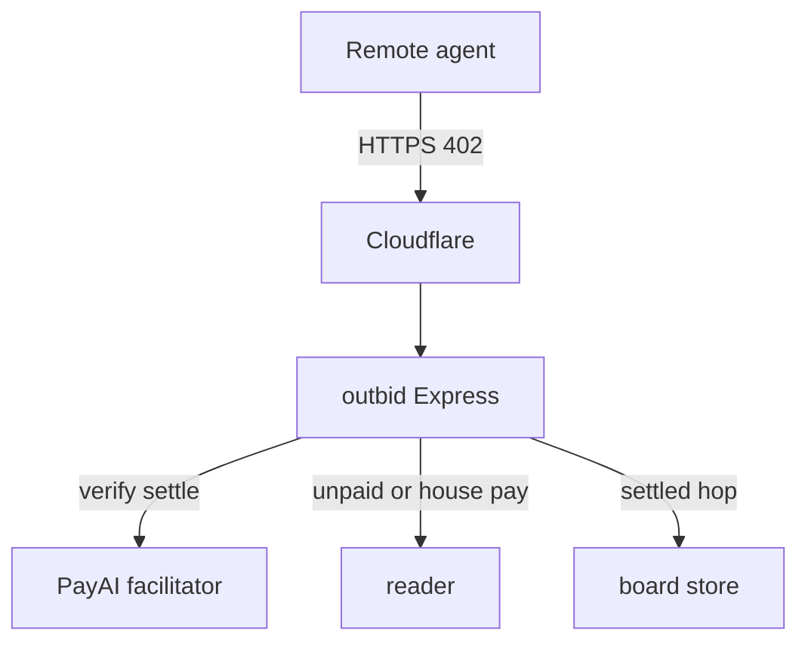

# outbid jobs threat model

Date: 2026-09-12. In-scope path: first-party jobs on the live outbid writer.

Assumption check-in (operator said GO; these assumptions stay in force):

- Apex is internet-exposed: Cloudflare tunnel `outbid-sh` → `127.0.0.1:4024` → `https://outbid.sh`.
- Auth is facilitator-verified x402 USDC. No sessions, no user accounts.
- After this GO, `JOBS_ENABLED=1`. `JOBS_READER_PAY` stays unset until a named house key is approved.
- Reader is a separate origin (`reader.outbid.sh` → `:4030`). Jobs proxy to it after settle.
- Attackers are remote unauthenticated HTTP clients and x402 clients. Host compromise is out of scope.

Questions that would change ranking (unanswered; proceeding):

1. Which wallet file, if any, will be `JOBS_PAY_MODULE` / the house SVM key?
2. Should Cloudflare 1010 stay on for odd UAs after jobs go live?

## Executive summary

The jobs surface turns outbid.sh from a leftover occupancy hop into named paid utilities (`scrape` $0.005, `browse` $0.05, `hop` $0.01). The highest-risk failure was treating any `x-payment` / `payment-signature` header as settlement (closed: fulfillment requires `req.outbidJobSettled`, set only after `@x402/express` `paymentMiddleware` calls `next()`). Residual highs: house-pay drain if a key is armed without a fuse; hop using stale/empty `nextAccepts` if `#1` rebuild skips `/job/hop` (mitigated in this GO); SSRF via `url=` (local preflight plus reader SSRF). House-pay is intentionally off on first GO, so a real settle against scrape/browse can still 502 `reader_requires_payment` rather than charge a second stranger.

## Scope and assumptions

**In-scope:** `src/jobs.mjs`, jobs mount / x402 registration / well-known resources in `src/server.js`, `skill/JOBS.md`, `test/jobs.test.js`, `outbid-jobs-threat-model.md`.

**Out-of-scope:** `wzrd-final`, intel/trust, AutoGate, RH/Kalshi/`trade`, mint/vault, reader process internals except as `READER_BASE_URL`, occupancy bid economics except hop reuse of `sendRoute` / `recordNext`.

**Assumptions:** internet-facing; x402-only auth; `JOBS_READER_PAY` unset; no multi-tenant accounts; payTo is venue (scrape/browse) or `#1` last_payer (hop); live `/skill.md` remains the leftover hop contract until a later GO.

**Open questions:** named house-pay key; CF 1010 policy; whether GET `/job/*` should share the POST `/bid` rate limiter.

## System model

### Primary components

- Express app (`src/server.js`) under `outbid-mainnet` on loopback `:4024`.
- `@x402/express` `paymentMiddleware` + PayAI facilitator (`FACILITATOR_URL`).
- `src/jobs.mjs` catalog + scrape/browse/hop handlers (mounted only if `JOBS_ENABLED=1`).
- Leftover board `src/store.js` (hop `dispatchTop` / `recordNext`).
- Backend reader at `READER_BASE_URL` (default `https://reader.outbid.sh`).

Runtime, not CI: this tree has no GitHub remote. Tests (`test/jobs.test.js`) are local Node test runner only.

### Data flows and trust boundaries

- Internet → Cloudflare → origin: public URL, `url=` query, payment headers. Channel: HTTPS at the edge, HTTP on loopback. Guarantee: TLS at CF; no session auth; POST `/bid` rate-limited 30/min (`makeBidLimiter`). Job GETs are not in that limiter. Validation: jobs `assertPublicHttpUrl` (scheme, host, DNS, private ranges) before settle check.
- Origin → PayAI facilitator: payment verify/settle. Channel: HTTPS. Guarantee: origin trusts facilitator success; `onAfterSettle` only after `result.success`. Data: payment payloads, payTo, amounts.
- Origin → reader: server-side GET `/scrape` or `/browse?url=`. Channel: HTTPS. Guarantee: client payment is not forwarded. House-pay fetch only if `JOBS_READER_PAY=1` and `JOBS_PAY_MODULE` imports. Data: attacker-chosen public URL.
- Origin → board JSON: hop after settle calls `sendRoute` → `recordNext`. Channel: local filesystem. Data: tx, payer, dispatch counters.

#### Diagram

## Assets and security objectives

| Asset | Why it matters | Security objective (C/I/A) |
|---|---|---|
| Facilitator-verified settlement | Only gate that a job was paid | I |
| Board `#1` / `dispatch_total` | Hop product and Path A metric | I |
| Reader backend / house USDC | Amplification and drain if house-pay armed | C / A |
| Venue and last_payer addresses | Wrong payTo steals settle | I |
| Board + env key files on host | Full take if leaked into git or logs | C |
| Origin availability (`:4024`) | Occupancy leftover plus jobs | A |

## Attacker model

### Capabilities

Remote HTTP to the apex. Arbitrary `url=`. Spoofed payment headers. Catalog and well-known discovery. Pay real USDC to exercise settled paths. Flood unmetered GETs.

### Non-capabilities

No loopback bind. No Doppler. No systemd. Cannot restart the unit. Cannot make `/call`. Cannot read wallet JSON over HTTP. Host compromise is out of scope.

## Entry points and attack surfaces

| Surface | How reached | Trust boundary | Notes | Evidence |
|---|---|---|---|---|
| `GET /jobs` | public | Internet → origin | Free catalog | `src/jobs.mjs` `mountJobs` |
| `GET /jobs.md` | public | Internet → origin | Jobs skill bytes | `src/jobs.mjs` `jobsMarkdown` |
| `GET /job/scrape` | public | Internet → origin | 402 then middleware | `src/server.js` `paymentMiddleware` `"GET /job/scrape"` |
| `GET /job/browse` | public | Internet → origin | $0.05 | same |
| `GET /job/hop` | public | Internet → origin | last_payer circuit | `nextAccepts` + `/job/hop` rebuild |
| `HEAD /job/*` | public | Internet → origin | Must stay 402 | `src/jobs.mjs` `head402` |
| `url=` | query | attacker → reader | SSRF preflight | `assertPublicHttpUrl` |
| `/.well-known/x402` | public | Internet → origin | Job prices must not be bid min | `src/server.js` well-known resources |
| Spectator MCP | public | Internet → origin | Cannot pay jobs | `src/mcp.js` |

## Top abuse paths

1. Spoof header → free scrape: send `x-payment: test` on `GET /job/scrape?url=` → expect handler to treat header as paid → free reader fetch. Impact: unpaid compute / leaked bytes. Mitigated: still 402 unless `outbidJobSettled`.
2. HEAD skip → free body: `HEAD /job/scrape` bypasses GET middleware → expect body. Mitigated: explicit HEAD 402.
3. SSRF: `url=http://127.0.0.1/` or metadata host → origin or reader probes internals. Mitigated: 400 `private target` plus reader SSRF.
4. Empty hop accepts: first `/job/hop` after restart before any `/route` → `nextAccepts` empty → broken or free hop. Mitigated: rebuild `nextAccepts` on `/job/hop`.
5. Wrong well-known price: discovery pays $0.01 for a $0.005 scrape or vice versa → failed settle or overpay. Mitigated: `formatJobPrice` on well-known job resources.
6. Pay outbid, reader still 402: stranger pays venue, origin fetches reader unpaid → 502. Impact: payer lost $0.005, no bytes (not house theft).
7. Arm house-pay with a guessed or Hermes key and no fuse: attacker loops settled scrapes → house USDC drain.
8. Settled hop spam: pay $0.01 repeatedly → inflate `dispatch_total` (now costs real money).
9. Flood `GET /jobs` / unpaid `/job/*`: unmetered GETs → origin CPU / facilitator chatter.

## Threat model table

| Threat ID | Threat source | Prerequisites | Threat action | Impact | Impacted assets | Existing controls (evidence) | Gaps | Recommended mitigations | Detection ideas | Likelihood | Impact severity | Priority |
|---|---|---|---|---|---|---|---|---|---|---|---|---|
| TM-001 | Remote client | Jobs live | Junk payment header as paid | Free fulfill | USDC, reader | `isSettled` only `outbidJobSettled`; flag set after middleware `next()` (`src/jobs.mjs`, `src/server.js`) | Regression if someone re-teaches header-as-pay | Keep tests that spoof stays 402 | 402 vs 200 ratio on `/job/*` | low | high | high |
| TM-002 | Remote client | Jobs live + hop | Free or empty-accepts hop | Metric wash, free URL, or broken 402 | board, last_payer | hop in `PAID_402_PATHS`; `nextAccepts` rebuilt on `/job/hop`; `onAfterSettle` `recordNext` | none if those stay registered | Do not drop hop from the rebuild list | `job settled` / `tick settled` logs | low | high | high |
| TM-003 | Remote client | Jobs live | `url=` SSRF | Internal probe via origin or reader | host, reader | `assertPublicHttpUrl` + reader SSRF | DNS rebinding race | Keep both gates | 400 `private target` count | medium | medium | medium |
| TM-004 | Remote client | House-pay armed | Force house to pay reader | House USDC drain | house wallet | `JOBS_READER_PAY` default off; no default key path | No daily fuse in outbid | Fuse + named key only | house ledger | medium | high | high |
| TM-005 | Remote client | Jobs live, house-pay off | Pay outbid, reader still 402 | Failed product (502). Authorization-flow settle is cancelled on ≥400, so USDC is not taken | payer UX | honest 502 `reader_requires_payment`; scrape/browse omitted from well-known until house-pay armed (`src/jobs.mjs`, `src/server.js`) | hop is the only advertised live fulfill | Arm house-pay after a named `JOBS_HOUSE_*` key | 502 rate vs verify | high | low | medium |
| TM-006 | Crawler | GET unmetered | Flood `/jobs` or unpaid job quotes | Availability | origin | Cloudflare | bid limiter is POST `/bid` only | Rate-limit GET `/job/*` | 429 / CF | medium | low | low |
| TM-007 | Discovery client | Jobs live | Well-known price ≠ live 402 | Failed pay or overpay | payer funds, trust | `formatJobPrice` on scrape/browse well-known rows | humans still read leftover `/skill.md` | Keep `/skill.md` hop until proven; `/jobs.md` is the job contract | mismatch alerts on well-known vs `FIRST_PARTY_JOBS` | low | medium | medium |

## Criticality calibration

- **Critical:** unauthenticated fulfillment or free hop on the public apex; key material in git or HTTP. Examples: header-as-pay (pre-fix); `/job/hop` calling `sendRoute` without settle; committing `payer.svm.json`.
- **High:** verified-pay bypass via header regression; house-key drain; hop with empty accepts that skips the paywall. Examples: TM-001 residual, TM-004, TM-002 before rebuild-on-hop.
- **Medium:** SSRF amplifier; paid-but-empty 502; discovery price lie. Examples: TM-003, TM-005, TM-007.
- **Low:** catalog scrape; CF 1010 on odd UAs; noisy unmetered GET. Examples: TM-006.

## Focus paths for security review

| Path | Why it matters | Related Threat IDs |
|---|---|---|
| `src/jobs.mjs` | Quote vs settle vs SSRF vs HEAD | TM-001 TM-003 |
| `src/server.js` | paymentMiddleware job routes, settled flag, hop rebuild, well-known prices | TM-001 TM-002 TM-007 |
| `src/store.js` | hop `dispatchTop` / `recordNext` | TM-002 |
| `skill/JOBS.md` | Must not teach header-as-pay | TM-001 |
| `test/jobs.test.js` | Regression for spoof / SSRF / prices | TM-001 TM-003 TM-007 |

## Notes on use

User clarifications: GO authorized; `/review` = Security Review (ran on the pre-fix tree; Critical was header-as-pay). House-pay key not named — TM-004 stays off, TM-005 remains until a later key GO. Live `/skill.md` remains leftover hop.

### Quality check

- Entry points in the table are the jobs surfaces plus well-known and spectator MCP.
- Each trust boundary (Internet→origin, origin→facilitator, origin→reader, origin→board) appears in at least one threat.
- Runtime vs tests/CI: no CI remote; tests are local evidence only.
- User non-response on house key and CF 1010 is explicit.
- Assumptions and open questions are listed above.
